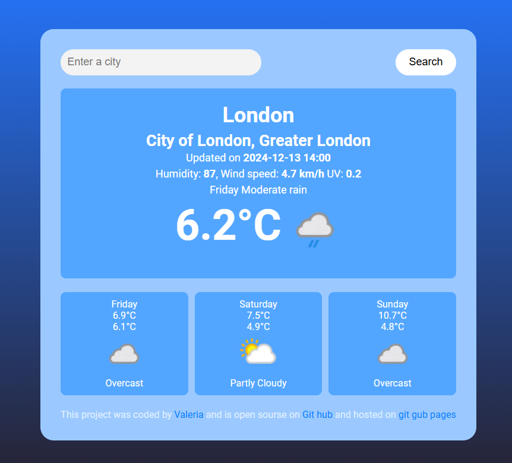

# Weather web app
Powered by https://www.weatherapi.com/ 

## Site preview 

- [**Site link**](https://zloygolub.github.io/Weather/)

## Usage
If you want to preview site while editing use extension **Open live server** to make preview convenient

## Secure API setup

The browser never calls WeatherAPI directly. Requests go through the Cloudflare
Worker in `worker/`, and the WeatherAPI key is stored as a Worker secret.

1. Revoke the key that was previously committed to this repository and create a
   new WeatherAPI key.
2. Install and authenticate Wrangler:
   ```sh
   cd worker
   npm install
   npx wrangler login
   ```
3. Store the new key as a secret (do not add it to a file):
   ```sh
   npx wrangler secret put WEATHER_API_KEY
   ```
4. Deploy the proxy:
   ```sh
   npm run deploy
   ```
5. Copy the deployed `workers.dev` URL into `src/config.js`, then publish the
   GitHub Pages site again.

For local Worker development, create `worker/.dev.vars` with
`WEATHER_API_KEY=your-development-key`. This file is ignored by Git.

JSON and XML Weather API and Geolocation Developer API
Designed for developers by developers, Weather API is the ultimate weather and geolocation API trusted by 500,000+ users worldwide.

Search Language: 
Language	        lang code
Arabic	            ar
Bengali	            bn
Bulgarian	        bg
Chinese Simplified	zh
Chinese Traditional	zh_tw
Czech	            cs
Danish	            da
Dutch	            nl
Finnish	            fi
French	            fr
German	            de
Greek	            el
Hindi	            hi
Hungarian	        hu
Italian	            it
Japanese	        ja
Javanese	        jv
Korean	            ko
Mandarin	        zh_cmn
Marathi	            mr
Polish	            pl
Portuguese	        pt
Punjabi	            pa
Romanian	        ro
Russian	            ru
Serbian	            sr
Sinhalese	        si
Slovak	            sk
Spanish	            es
Swedish	            sv
Tamil	            ta
Telugu	            te
Turkish	            tr
Ukrainian	        uk
Urdu	            ur
Vietnamese	        vi
Wu (Shanghainese)	zh_wuu
Xiang	            zh_hsn
Yue (Cantonese)	    zh_yue
Zulu	            zu
